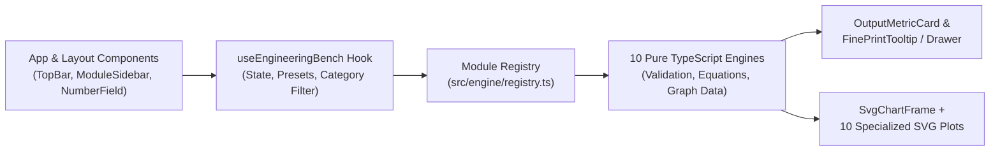

# StrataBench — Mechanical & Civil Engineering Workbench


**StrataBench** is a client-side mechanical and civil engineering calculation workbench built with React, TypeScript, and custom interactive SVG analytical plots. Engineers enter numeric parameters with physical units and immediately inspect computed outputs, pass/fail safety verdicts, crosshair-probed graphs, and fine-print governing equations.

---

## Implemented Engineering Modules

| # | Module | Discipline | Key Inputs | Analytical Outputs & Plot |
|:-:|:---|:---|:---|:---|
| 01 | **Mohr's Circle (2D & 3D)** | Solid Mechanics | $\sigma_x, \sigma_y, \sigma_z, \tau_{xy}, \theta$ | Principal stresses ($\sigma_1, \sigma_2, \sigma_3$), $\tau_{\max}$, $\theta_p$, rotated stress state |
| 02 | **Stress–Strain Curve** | Solid Mechanics | Material grade, $F, A_0, L_0$ | Young's modulus $E$, $0.2\%$ offset yield, UTS, fracture strain, toughness $U_T$ |
| 03 | **S–N Curve (Wöhler Diagram)** | Fatigue & Failure | $\sigma_a$, material grade, surface finish $k_a$ | Log–log Basquin curve, cycles to failure $N_f$, modified endurance limit $S_e$ |
| 04 | **Goodman / Haigh Diagram** | Fatigue & Failure | $\sigma_m, \sigma_a, S_e, S_y, S_{ut}$ | Safety factors ($n_G, n_y, n_S, n_{\text{Gerber}}$), safe envelope polygon |
| 05 | **Shear Force & Bending Moment** | Structural | Support type, $L, P, a, w$ | Reactions, aligned $V(x)$ SFD & $M(x)$ BMD, zero-moment inflection points |
| 06 | **Mohr–Coulomb Envelope** | Geotechnical | $c, \phi, \sigma_3, \sigma_1$ | Shear capacity $\tau_f$, failure plane $\theta_f = 45^\circ + \phi/2$, Factor of Safety |
| 07 | **Ashby Material Selection** | Materials | Property pair ($E/\rho$ or $\sigma_y/\rho$), slope $m$, $M_{\min}$ | Log–log material bubbles, iso-performance guideline, ranked candidate table |
| 08 | **Euler Column Buckling** | Structural | End-fixity $K$, $L, r, A, E, \sigma_y$ | Critical load $P_{cr}$, Euler vs. Johnson transition $C_c$, buckling curve |
| 09 | **P–M Interaction Diagram** | Structural | $b, h, f'_c, \rho_g, P_u, M_u$ | ACI 318 nominal & $\phi$-factored envelopes, balanced point, $D/C$ utilization |
| 10 | **Casagrande Plasticity Chart** | Geotechnical | $LL, PL$, organic behavior flag | $PI = LL - PL$, A-line & U-line chart, USCS symbol (`CL`, `CH`, `ML`, `MH`, `CL-ML`) |

---

## Architecture Overview



---

## Local Development & Verification

```bash
# Install dependencies
npm install

# Start development server (port 3000)
npm run dev

# Run TypeScript typecheck
npm run lint

# Run Vitest unit & React Testing Library integration tests
npm test

# Build production bundle
npm run build
```

---

## GitHub Pages Deployment

Automated deployment is configured in `.github/workflows/deploy.yml` on pushes to `main`. The workflow runs `npm run lint`, `npm test`, and builds with `GITHUB_PAGES=true npm run build` so `vite.config.ts` applies the `/engineering-bench/` base path for static asset resolution.
